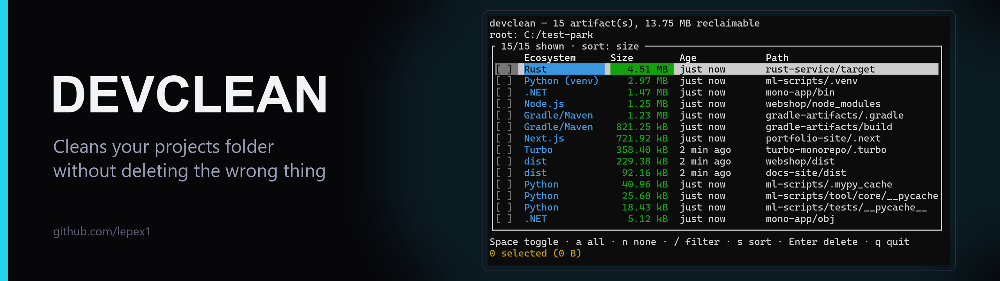
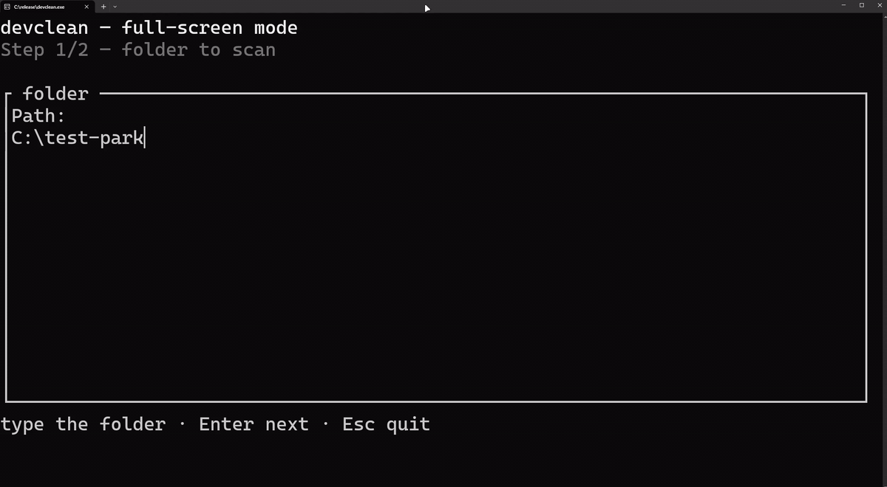
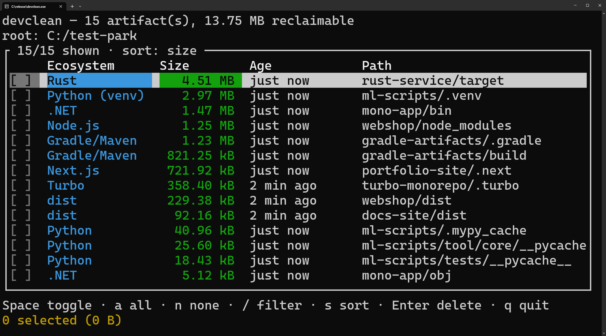
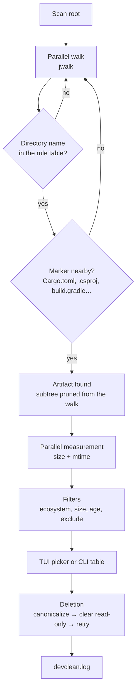

<p align="center">
  <a href="README.md">Русский</a> · <b>English</b>
</p>

# devclean

<!-- BANNER SLOT: add assets/banner.en.png (2560×720, show as width="1280") then uncomment.
<p align="center">
  
</p>
-->

<p align="center">
  
  
  
  <a href="LICENSE"></a>
</p>

<p align="center">
  <b>Finds build artifacts and caches across your projects folder,<br>
  shows the size and age of each one, and deletes only what you tick.</b>
</p>

## Demo

<p align="center">
  
</p>

---

## Why it exists

After a few months of work a projects folder easily grows to tens of gigabytes: a `node_modules` per frontend, a `target` per Rust crate, `bin`/`obj` per .NET build. Cleaning it by hand is slow and risky — it is easy to hit the wrong directory.

`devclean` does it for you:

1. **Walks the tree in parallel** (`jwalk` + `rayon`) and never descends into an artifact it has already found, so nested directories are not counted twice.
2. **Only confirmed directories count as artifacts**: `target` next to `Cargo.toml` or `pom.xml`, `bin`/`obj` next to a project file, `build` next to `build.gradle`. A personal folder with the same name is left alone.
3. **Measures size and age** in parallel; symlinks are skipped during measurement.
4. **Shows the list** in a full-screen TUI with ecosystem, size and age filters — or as a plain table in the CLI.
5. **Deletes only what you tick**: the path is canonicalized (Windows long paths), read-only attributes are cleared, removal is retried on transient locks, and a symlink is removed as a link.

On a real folder of ~35 projects a typical run finds **66 artifacts taking 13.5 GB**.

---

## Screenshot

<p align="center">
  
</p>

---

## Compatibility

| Item | Value |
|---|---|
| **OS** | Windows 10/11 — tested. Linux and macOS — the code is cross-platform and builds, but has mostly been tested on Windows |
| **Modes** | Full-screen TUI (double-click the exe), interactive checklist, table plus flags for scripts |
| **Detection** | Known directory names only, each confirmed by marker files next to it |
| **Deletion** | No recycle bin. Symlinks and junctions are removed as links, their target stays |
| **Log** | `devclean.log` next to the exe (fallback: working directory), rotates at 10 MB |
| **Build** | Rust 1.88+ (edition 2024) |

---

## Quick start (Windows)

1. Download **`devclean.exe`** from the **[Releases](https://github.com/lepex1/devclean/releases/latest)** page — or build it yourself, it is one command (see below).
2. Double-click the file: the full-screen TUI opens and the window stays open after a clean.
3. **Step 1/2 — folder:** type the path to your projects folder and press Enter. The last folder is remembered.
4. **Step 2/2 — filters:** `o` age, `m` minimum size, `t` ecosystem. Optional: Enter scans right away.
5. **List:** tick what you need with `Space`, press Enter, confirm with `y`.

**Where the log is:** `devclean.log` next to the `.exe` (and `devclean.log.1` after rotation). The program writes nothing else: no settings, no installation.

---

## Build from source

```bash
git clone https://github.com/lepex1/devclean.git
cd devclean
cargo build --release
```

The binary ends up in `target/release/devclean.exe` (Windows) or `target/release/devclean`. **Requirements:** Rust 1.88+, and the MSVC toolchain on Windows.

### Checks before building

```bash
cargo test                                  # 56 tests
cargo clippy --all-targets -- -D warnings
cargo fmt --check
```

---

## Usage

### Full-screen mode

| Key | Action |
|---|---|
| `↑` / `↓` or `j` / `k` | Move through the list |
| `Space` | Tick/untick the row |
| `a` / `n` | Tick all visible / untick all visible |
| `/` | Live filter by path and ecosystem |
| `s` | Sort: size ↓ → age (oldest first) → ecosystem → path |
| `Enter` | Delete ticked items, then `y` to confirm |
| `q` / `Esc` | Quit without deleting |

Command keys work regardless of Caps Lock. The TUI needs a real terminal: when launched through a pipe the program reports an error instead of hanging.

### CLI

```bash
devclean                                  # full-screen TUI
devclean D:/projects                      # scan and print a table
devclean D:/projects --older-than 30d --min-size 100MB
devclean D:/projects --type node,rust -i  # interactive checklist
devclean D:/projects --tui                # full-screen picker after a CLI scan
devclean D:/projects --all --dry-run      # show what would be removed
devclean D:/projects --all --yes          # remove everything found, no prompts
devclean --menu                           # the old step-by-step menu
```

| Flag | Meaning |
|---|---|
| `--older-than 30d` | Only artifacts unchanged for that long (`s`, `min`, `h`, `d`, `w`, `m`, `y`; combined as `1y2w3d`) |
| `--min-size 100MB` | Minimum size (decimal MB/GB and binary MiB/GiB) |
| `--type node,rust` | Ecosystems: `node`, `rust`, `python`, `java`, `dotnet`, `generic` |
| `--exclude "**/backup/**"` | Exclude paths; `*` stays inside one segment, `**` crosses segments, a plain pattern is a substring match |
| `-i, --interactive` | Terminal checklist |
| `--tui` | Full-screen picker after the CLI scan |
| `--all` + `--yes` | Remove everything found; without `--yes` the command refuses |
| `--dry-run` | Delete nothing |
| `--menu` | Step-by-step menu instead of the TUI |

Exit codes: `0` success, `1` error or some artifacts failed to delete, `2` invalid arguments, `130` interrupted by Ctrl+C (partial result).

---

## How it works



What makes the detection different from "delete everything called build":

- **Confirmation by markers**: the directory name is only a hint, a file next to it decides. Without a marker the directory is not an artifact.
- **Filters before measurement**: `--type` and `--exclude` prune branches during the walk, so gigabytes of other ecosystems are never even measured.
- **Safe links**: when deleting, a symlink or junction is removed itself; its target is never entered.
- **Root guard**: scanning a disk root, the whole home directory, `C:\Windows` or `Program Files` is refused.
- **Every decision is logged**: found / measured / filtered / removed / failed — with the path and the reason.

---

## What gets detected

| Ecosystem | Directories |
|---|---|
| Node.js | `node_modules`, `.next`, `.nuxt`, `.turbo`, `dist` (with `package.json` / config) |
| Rust | `target` (with `Cargo.toml`) |
| Java / Kotlin | `build`, `.gradle` (with `build.gradle`/`settings.gradle`), `target` (with `pom.xml`) |
| .NET | `bin`, `obj` (with `.csproj`, `.fsproj`, `.vbproj` or `.sln`) |
| C++ (Visual Studio) | `bin`, `obj` (with `.vcxproj`) |
| Python | `.venv`, `venv`, `env`, `__pycache__`, `.pytest_cache`, `.mypy_cache` |
| Generic | `dist` (with `pyproject.toml`) |

---

## ⚠️ Things to know

- **Deletion is permanent** — no recycle bin. Check `--dry-run` or the TUI list first.
- **`--all --yes` deletes without per-item confirmation.** Use it deliberately.
- **Only the artifact types listed above are supported.** CMake `build`, Swift `.build`, Elixir `_build`, Ruff caches and similar are intentionally not detected, to avoid deleting the wrong thing.
- **Backups and `tmp` folders inside the scan root are found too** — exclude them with `--exclude`.
- **Linux/macOS** build, but are tested less than Windows.
- The log runs at Trace level: it grows quickly during active use, but rotates at 10 MB (one previous file is kept).

---

## FAQ

**Why did a folder fail to delete?**
Another process holds it (IDE, build, antivirus). Close it and retry; the path and the reason are in `devclean.log`.

**Can I undo a deletion?**
No. No recycle bin is used; deletion is final.

**Where is the log?**
Next to the exe: `devclean.log` (and `devclean.log.1` after rotation). If the exe folder is read-only, it goes to the current working directory.

**Why was a CMake `build` not found?**
That type is not supported yet: the `build` rule requires Gradle markers, otherwise a personal folder with the same name could be deleted.

**Does it follow symlinks?**
No. When deleting, the link itself is removed and its target stays.

**Can I run it on a schedule?**
Yes: `devclean D:/projects --older-than 30d --type node --all --yes --dry-run` prints the plan, and the same call without `--dry-run` performs it.

---

## License

[MIT](LICENSE) — use it, fork it, change it.

Dependencies are distributed under MIT, Apache-2.0, BSD and Unlicense.

---

<p align="center">
  Made by <a href="https://lepex.vercel.app/">lepex1</a>
</p>
