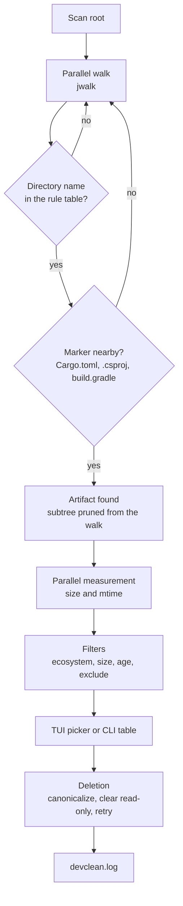

<p align="center">
  <a href="README.md">Русский</a> · <b>English</b>
</p>

# devclean

<p align="center">
  
</p>

<p align="center">
  <a href="https://github.com/lepex1/devclean/releases/latest"></a>
  <a href="https://github.com/lepex1/devclean/releases"></a>
  
  
  <a href="LICENSE"></a>
</p>

<p align="center">
  <b>Walks your projects folder, finds build artifacts by name and by the markers next to them,<br>
  shows the size and age of each one, and deletes only what you tick.</b>
</p>

## Demo

<p align="center">
  
</p>

---

## Screenshot

<p align="center">
  
</p>

---

## Why it exists

After a few months of work a projects folder easily grows to tens of gigabytes: a `node_modules` per frontend, a `target` per Rust crate, `bin`/`obj` per .NET build. Cleaning it by hand is slow and risky — it is easy to hit the wrong directory, and there is no undo.

`devclean` does it for you:

1. **Walks** the tree in parallel and never descends into an artifact it has already found, so nested directories are not counted twice.
2. **Confirms** every directory by the markers next to it: `target` only with `Cargo.toml` or `pom.xml`, `bin`/`obj` only with a project file. A personal folder with the same name is left alone.
3. **Measures** size and age in parallel; symlinks are skipped during measurement.
4. **Shows** the list in a full-screen TUI with ecosystem, size and age filters — or as a table in the CLI.
5. **Deletes** only what you tick: the path is canonicalized, read-only attributes are cleared, a locked directory is retried, and a symlink is removed as a link.

On a folder of 30–40 projects a typical run finds 40–70 artifacts taking 10–14 GB.

---

## Compatibility

| Item | Value |
|---|---|
| **OS** | Windows 10/11 — tested. Linux and macOS — the code is cross-platform and builds, but has mostly been tested on Windows |
| **Modes** | Full-screen TUI (double-click the exe), interactive checklist, table and flags for scripts |
| **Formats** | Detects directories of Node.js, Rust, Java/Kotlin, .NET, C++ (Visual Studio) and Python; see the list below |
| **Deletion** | No recycle bin. Symlinks and junctions are removed as links, their target stays |
| **Log** | `devclean.log` next to the exe, rotates at 10 MB |
| **Build** | Rust 1.88+ (edition 2024) |

---

## Quick start (Windows)

1. Download **`devclean.exe`** from the **[Releases](https://github.com/lepex1/devclean/releases/latest)** page.
2. Run the file. SmartScreen may warn you — that is normal for unsigned builds: "More info" → "Run anyway".
3. **Step 1/2 — folder:** type the path to your projects folder and press Enter. **Step 2/2 — filters:** `o` age, `m` minimum size, `t` ecosystem; Enter starts the scan.
4. **List:** tick what you need with `Space`, press Enter, confirm with `y`. The window stays open after a clean and returns to folder selection.

**Where the result is:** `devclean.log` next to the `.exe` (`devclean.log.1` after rotation) and `last-scan-directory.txt` with the last folder. The program writes nothing else: no installation, no settings.

---

## Usage

| Key | Action |
|---|---|
| `↑` / `↓` or `j` / `k` | Move through the list |
| `Space` | Tick/untick the row |
| `a` / `n` | Tick all visible / untick all visible |
| `/` | Live filter by path and ecosystem |
| `s` | Sort: size ↓ → age (oldest first) → ecosystem → path |
| `Enter` | Delete ticked items, then `y` to confirm |
| `q` / `Esc` | Quit without deleting |

Command keys work regardless of Caps Lock. The TUI needs a real terminal: when launched through a pipe the program reports an error instead of hanging.

```bash
devclean D:/projects                      # scan and print a table
devclean D:/projects --older-than 30d --min-size 100MB
devclean D:/projects --type node,rust -i  # interactive checklist
devclean D:/projects --tui                # full-screen picker after a scan
devclean D:/projects --all --dry-run      # show what would be removed
devclean D:/projects --all --yes          # remove everything found, no prompts
devclean --menu                           # step-by-step menu instead of the TUI
```

| Flag | Meaning |
|---|---|
| `--older-than 30d` | Only artifacts unchanged for that long (`s`, `min`, `h`, `d`, `w`, `m`, `y`; combined as `1y2w3d`) |
| `--min-size 100MB` | Minimum size (decimal MB/GB and binary MiB/GiB) |
| `--type node,rust` | Ecosystems: `node`, `rust`, `python`, `java`, `dotnet`, `generic` |
| `--exclude "**/backup/**"` | Exclude paths; `*` stays inside one segment, `**` crosses segments, a plain pattern is a substring match |
| `-i, --interactive` | Terminal checklist |
| `--tui` | Full-screen picker after the CLI scan |
| `--all` + `--yes` | Remove everything found; without `--yes` the command refuses |
| `--dry-run` | Delete nothing |
| `--menu` | Step-by-step menu instead of the TUI |

Exit codes: `0` success, `1` error or some artifacts failed to delete, `2` invalid arguments, `130` interrupted by Ctrl+C.

---

## Run from source

```bash
git clone https://github.com/lepex1/devclean.git
cd devclean
cargo run --release -- D:/projects
```

**Requirements:** Rust 1.88+, and the MSVC toolchain on Windows.

### Build a standalone .exe

```bash
cargo build --release
```

The result is `target/release/devclean.exe` (≈2 MB, all crates statically linked, nothing to install next to it). Before building you can run the checks:

```bash
cargo test
cargo clippy --all-targets -- -D warnings
cargo fmt --check
```

---

## How it works



- **The marker decides, not the name**: a `build` directory without `build.gradle` next to it is not an artifact, so personal folders with common names never reach the list.
- **Filters run before measurement**: `--type` and `--exclude` prune branches during the walk, so gigabytes of other ecosystems are never measured.
- **Links are not dereferenced**: when deleting, a symlink or junction is removed itself; its target is never entered.
- **Every decision is logged**: found, measured, filtered, removed, failed — with the path and the reason.

### What gets detected

| Ecosystem | Directories |
|---|---|
| Node.js | `node_modules`, `.next`, `.nuxt`, `.turbo`, `dist` (with `package.json` or config) |
| Rust | `target` (with `Cargo.toml`) |
| Java / Kotlin | `build`, `.gradle` (with `build.gradle`/`settings.gradle`), `target` (with `pom.xml`) |
| .NET | `bin`, `obj` (with `.csproj`, `.fsproj`, `.vbproj` or `.sln`) |
| C++ (Visual Studio) | `bin`, `obj` (with `.vcxproj`) |
| Python | `.venv`, `venv`, `env`, `__pycache__`, `.pytest_cache`, `.mypy_cache` |
| Generic | `dist` (with `pyproject.toml`) |

---

## ⚠️ Read this

- **Deletion is permanent**: no recycle bin. Check `--dry-run` or the TUI list first.
- **`--all --yes` deletes without per-item confirmation.** Use it deliberately, ideally together with `--dry-run`.
- **Only the directories in the table above are supported.** CMake `build`, Swift `.build`, Elixir `_build`, Ruff caches and similar are intentionally not detected, to avoid deleting the wrong thing.
- **Backups and `tmp` folders inside the scan root are found too** — exclude them with `--exclude`.
- **Linux/macOS** build, but are tested less than Windows. The log runs at Trace level and rotates at 10 MB.

---

## FAQ

**Why did a folder fail to delete?**
Another process holds it: IDE, build, antivirus. Close it and retry — the path and the reason are in `devclean.log`.

**SmartScreen warns about the `.exe`.**
That is normal for unsigned builds (a signing certificate costs money). You can skip the binary and build it yourself: `cargo build --release`.

**Can I undo a deletion?**
No. No recycle bin is used; deletion is final.

**Why was a CMake `build` not found?**
That type is not supported yet: the `build` rule requires Gradle markers, otherwise a personal folder with the same name could be deleted.

**Can I run it on a schedule?**
Yes: `devclean D:/projects --older-than 30d --type node --all --yes --dry-run` prints the plan, and the same call without `--dry-run` performs it.

---

## License

[MIT](LICENSE) — use it, fork it, change it.

The list of third-party components and their licenses is in [THIRD-PARTY-NOTICES.md](THIRD-PARTY-NOTICES.md). The project is not affiliated with GitHub, Microsoft or the crate authors.

---

<p align="center">
  Built by <a href="https://lepex.vercel.app/">lepex1</a>
</p>
