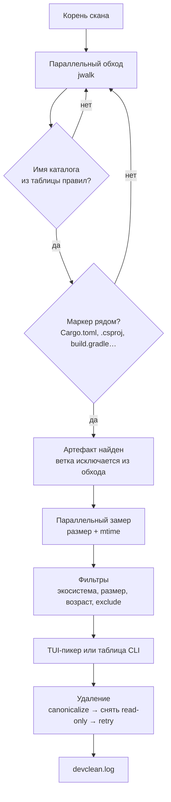

<p align="center">
  <b>Русский</b> · <a href="README.en.md">English</a>
</p>

# devclean

<!-- БАННЕР-СЛОТ: положить assets/banner.png (2560×720, показывать width="1280") и раскомментировать.
<p align="center">
  
</p>
-->

<p align="center">
  
  
  
  <a href="LICENSE"></a>
</p>

<p align="center">
  <b>Находит артефакты сборки и кэши в папке с проектами,<br>
  показывает размер и возраст каждого и удаляет только отмеченное.</b>
</p>

## Демонстрация

<p align="center">
  
</p>

---

## Зачем это нужно

После нескольких месяцев работы папка с проектами легко набирает десятки гигабайт: `node_modules` от каждого фронтенда, `target` от каждого Rust-крейта, `bin`/`obj` от каждой .NET-сборки. Чистить это руками долго и страшно — легко задеть не тот каталог.

`devclean` делает это сам:

1. **Обходит дерево параллельно** (`jwalk` + `rayon`) и не спускается внутрь уже найденного артефакта — вложенные каталоги не считаются дважды.
2. **Считает артефактом только подтверждённый каталог**: `target` рядом с `Cargo.toml` или `pom.xml`, `bin`/`obj` рядом с project-файлом, `build` рядом с `build.gradle`. Личная папка с тем же именем остаётся нетронутой.
3. **Меряет размер и возраст** параллельно, симлинки при замере пропускаются.
4. **Показывает список** в полноэкранном TUI с фильтрами по экосистеме, размеру и возрасту — или обычной таблицей в CLI.
5. **Удаляет только отмеченное**: путь канонизируется (Windows-длинные пути), read-only-атрибуты снимаются, при транзиентных блокировках удаление повторяется, симлинк удаляется как ссылка.

На реальной папке из ~35 проектов типичный результат — **66 артефактов на 13.5 GB**.

---

## Скриншот

<p align="center">
  
</p>

---

## Совместимость

| Параметр | Значение |
|---|---|
| **ОС** | Windows 10/11 — протестировано. Linux и macOS — код кроссплатформенный и собирается, но проверялся в основном на Windows |
| **Режимы** | Полноэкранный TUI (двойной клик по exe), интерактивный чек-лист, таблица + флаги для скриптов |
| **Детект** | Только известные типы каталогов, каждый подтверждается файлами-маркерами рядом |
| **Удаление** | Без корзины. Симлинки и junction удаляются как ссылки, цель остаётся |
| **Лог** | `devclean.log` рядом с exe (fallback — рабочая папка), ротация при 10 MB |
| **Сборка** | Rust 1.88+ (edition 2024) |

---

## Быстрый старт (Windows)

1. Скачай **`devclean.exe`** со страницы **[Releases](https://github.com/lepex1/devclean/releases/latest)** — или собери сам, это одна команда (см. ниже).
2. Запусти файл двойным кликом: откроется полноэкранный TUI, окно не закроется после очистки.
3. **Шаг 1/2 — папка:** введи путь к папке с проектами и нажми Enter. Последняя папка запоминается.
4. **Шаг 2/2 — фильтры:** `o` — возраст, `m` — минимальный размер, `t` — экосистема. Необязательно: Enter сразу запускает скан.
5. **Список:** отметь нужное `Space`, нажми Enter и подтверди `y`.

**Где лог:** `devclean.log` рядом с `.exe` (и `devclean.log.1` после ротации). Больше программа ничего не пишет: настройки не нужны, установка не нужна.

---

## Запуск из исходников

```bash
git clone https://github.com/lepex1/devclean.git
cd devclean
cargo build --release
```

Результат — `target/release/devclean.exe` (Windows) или `target/release/devclean`. **Требования:** Rust 1.88+, на Windows — MSVC-тулчейн.

### Проверка перед сборкой

```bash
cargo test                                  # 56 тестов
cargo clippy --all-targets -- -D warnings
cargo fmt --check
```

---

## Использование

### Полноэкранный режим

| Клавиша | Действие |
|---|---|
| `↑` / `↓` или `j` / `k` | Перемещение по списку |
| `Space` | Отметить/снять строку |
| `a` / `n` | Отметить все видимые / снять все видимые |
| `/` | Живой фильтр по пути и экосистеме |
| `s` | Сортировка: размер ↓ → возраст (старые первыми) → экосистема → путь |
| `Enter` | Удалить отмеченное, затем `y` для подтверждения |
| `q` / `Esc` | Выход без удаления |

Командные клавиши работают независимо от Caps Lock. TUI требует настоящий терминал: при запуске в пайпе программа сообщает об ошибке, а не зависает.

### CLI

```bash
devclean                                  # полноэкранный TUI
devclean D:/projects                      # скан и таблица
devclean D:/projects --older-than 30d --min-size 100MB
devclean D:/projects --type node,rust -i  # интерактивный чек-лист
devclean D:/projects --tui                # полноэкранный выбор после скана
devclean D:/projects --all --dry-run      # показать, что будет удалено
devclean D:/projects --all --yes          # удалить всё найденное без вопросов
devclean --menu                           # старый пошаговый мастер
```

| Флаг | Значение |
|---|---|
| `--older-than 30d` | Только артефакты, не изменявшиеся указанное время (`s`, `min`, `h`, `d`, `w`, `m`, `y`; можно `1y2w3d`) |
| `--min-size 100MB` | Минимальный размер (десятичные MB/GB и двоичные MiB/GiB) |
| `--type node,rust` | Экосистемы: `node`, `rust`, `python`, `java`, `dotnet`, `generic` |
| `--exclude "**/backup/**"` | Исключить пути; `*` — в пределах сегмента, `**` — через сегменты, без звёздочек — подстрока |
| `-i, --interactive` | Чек-лист в терминале |
| `--tui` | Полноэкранный выбор после CLI-скана |
| `--all` + `--yes` | Удалить всё найденное; без `--yes` команда откажется |
| `--dry-run` | Ничего не удалять |
| `--menu` | Пошаговый мастер вместо TUI |

Коды возврата: `0` — успех, `1` — ошибка или часть артефактов не удалилась, `2` — неверные аргументы, `130` — прервано Ctrl+C (частичный результат).

---

## Как работает



Что отличает детект от «удалить всё, что называется build»:

- **Подтверждение по маркерам**: имя каталога — только повод проверить, решает наличие файла рядом. Без маркера каталог не считается артефактом.
- **Фильтры до замера**: `--type` и `--exclude` отсекают ветки на обходе, поэтому гигабайты чужих экосистем даже не считаются.
- **Безопасные ссылки**: при удалении симлинк или junction удаляется сам, переход к цели не выполняется.
- **Защита от корней**: сканирование корня диска, домашней папки целиком, `C:\Windows`, `Program Files` отклоняется.
- **Каждое решение в лог**: найдено / замерено / отфильтровано / удалено / ошибка — с путём и причиной.

---

## Какие артефакты находятся

| Экосистема | Каталоги |
|---|---|
| Node.js | `node_modules`, `.next`, `.nuxt`, `.turbo`, `dist` (рядом `package.json` / конфиг) |
| Rust | `target` (рядом `Cargo.toml`) |
| Java / Kotlin | `build`, `.gradle` (рядом `build.gradle`/`settings.gradle`), `target` (рядом `pom.xml`) |
| .NET | `bin`, `obj` (рядом `.csproj`, `.fsproj`, `.vbproj` или `.sln`) |
| C++ (Visual Studio) | `bin`, `obj` (рядом `.vcxproj`) |
| Python | `.venv`, `venv`, `env`, `__pycache__`, `.pytest_cache`, `.mypy_cache` |
| Generic | `dist` (рядом `pyproject.toml`) |

---

## ⚠️ Важно понимать

- **Удаление необратимо** — корзина не используется. Сначала проверяй `--dry-run` или список в TUI.
- **`--all --yes` удаляет без подтверждения каждого элемента.** Используй осознанно.
- **Поддерживаются только перечисленные выше артефакты.** CMake-`build`, Swift `.build`, Elixir `_build`, кэши Ruff и подобные намеренно не детектятся, чтобы не удалить лишнее.
- **Резервные копии и `tmp`-папки внутри корня скана тоже находятся** — исключай их через `--exclude`.
- **Linux/macOS** собираются, но тестировались меньше, чем Windows.
- Лог пишется на уровне Trace: при активной работе он растёт быстро, но ротируется при 10 MB (хранится один предыдущий файл).

---

## Частые вопросы

**Почему папка не удалилась?**
Её держит другой процесс (IDE, сборка, антивирус). Закрой его и повтори; причина с путём есть в `devclean.log`.

**Можно ли отменить удаление?**
Нет. Корзина не используется, удаление окончательное.

**Где лежит лог?**
Рядом с exe: `devclean.log` (и `devclean.log.1` после ротации). Если папка exe доступна только для чтения — в текущей рабочей папке.

**Почему не найден `build` от CMake?**
Этот тип пока не поддерживается: правило для `build` требует Gradle-маркеров, иначе легко удалить личную папку с тем же именем.

**Программа следует по симлинкам?**
Нет. При удалении ссылка удаляется сама, цель остаётся.

**Можно ли запускать по расписанию?**
Да: `devclean D:/projects --older-than 30d --type node --all --yes --dry-run` покажет план, тот же вызов без `--dry-run` его выполнит.

---

## Лицензия

[MIT](LICENSE) — используй, форкай, меняй.

Зависимости распространяются под MIT, Apache-2.0, BSD и Unlicense.

---

<p align="center">
  Сделал <a href="https://lepex.vercel.app/">lepex1</a>
</p>
