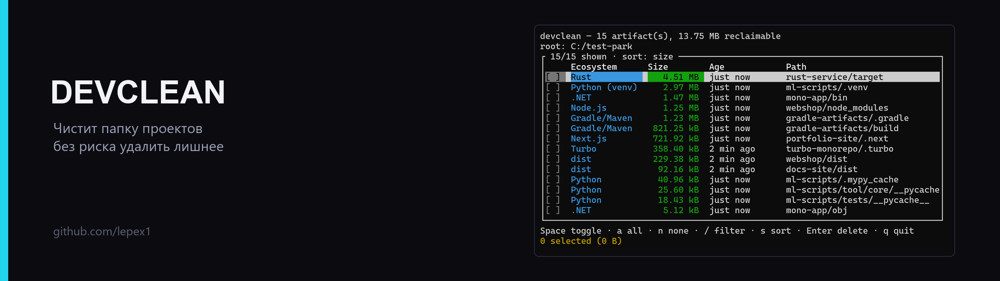
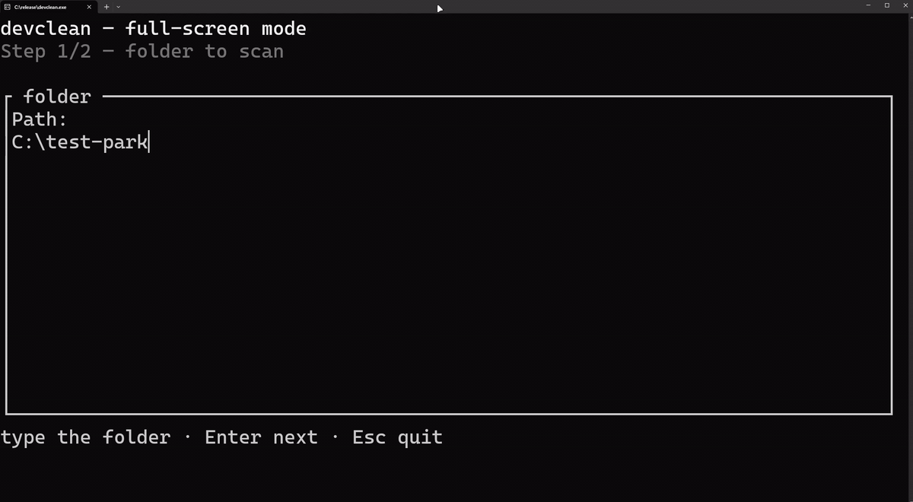
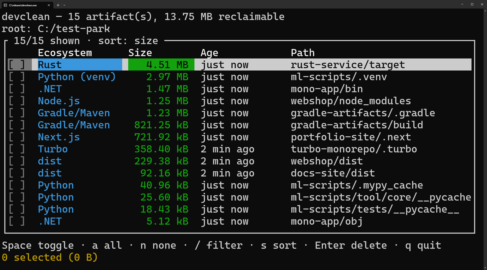

<b>Русский</b> · <a href="README.en.md">English</a>

# devclean

<!-- БАННЕР-СЛОТ: assets/banner.png (2560×720, показывать width="1280") и раскомментировать.
<p align="center">
  
</p>
-->


**Находит и безопасно удаляет артефакты сборки и кэши** — `node_modules`, `target`, `.venv`, `__pycache__`, `bin`/`obj`, `dist` и другие. Без аргументов на терминале открывается полноэкранный TUI: папка → фильтры → скан → выбор → удаление.

## Демонстрация

<p align="center">
  
</p>

## Скриншот

<p align="center">
  
</p>

## Зачем это нужно

После нескольких месяцев работы папка с проектами легко набирает десятки гигабайт: `node_modules` от каждого фронтенда, `target` от каждого Rust-крейта, `bin`/`obj` от каждой .NET-сборки. Чистить это руками долго и страшно — легко задеть не тот каталог.

devclean обходит дерево, находит только известные артефакты (по имени **и** файлам-маркерам рядом), показывает размер и возраст каждого, а удаляет только то, что вы отметили.

## Возможности

| | |
|---|---|
| **Полноэкранный TUI** | Двойной клик по exe или `devclean` без аргументов: папка, фильтры, скан, список с чекбоксами, удаление. Окно не закрывается после очистки. |
| **Параллельный скан** | `jwalk` + `rayon`: обход дерева и замер размеров идут параллельно, найденные артефакты не обходятся повторно. |
| **Детект с маркерами** | `target` считается артефактом только рядом с `Cargo.toml` или `pom.xml`, `bin`/`obj` — рядом с project-файлом. Личные папки с такими же именами не трогаются. |
| **Фильтры** | По экосистеме, минимальному размеру, возрасту и glob-исключениям. Фильтры по типу и исключениям применяются до замера — лишние гигабайты не обходятся. |
| **Безопасное удаление** | Симлинки и junction удаляются как ссылки, без перехода к цели. Защита от сканирования корней дисков, домашней папки и системных каталогов. Подтверждение перед удалением. |
| **CLI и TUI** | Один движок: скрипты используют флаги, человек — полноэкранный интерфейс. |
| **Лог рядом с exe** | `devclean.log` пишется рядом с бинарником (fallback — рабочая папка), ротация при 10 МБ. |

## Совместимость и требования

- **Windows 10/11** — основная и протестированная платформа.
- **Linux и macOS** — код кроссплатформенный, но проверялся в основном на Windows.
- **Сборка:** Rust 1.88+ (edition 2024).
- Готовый `devclean.exe` — в разделе Releases (после первого релиза).

## Установка

### Готовая сборка

Скачайте `devclean.exe` из раздела Releases и запустите. Установка не нужна — программа не пишет ничего, кроме лога и файла с последней папкой рядом с exe.

### Из исходников

```sh
git clone https://github.com/lepex1/devclean
cd devclean
cargo build --release
```

Бинарник появится в `target/release/devclean.exe` (Windows) или `target/release/devclean`.

## Использование

### Полноэкранный режим

Запустите exe двойным кликом или выполните `devclean` без аргументов в терминале.

1. **Папка** — введите путь (Enter — дальше). Запоминается последняя использованная папка.
2. **Фильтры** — `o` возраст, `m` минимальный размер, `t` экосистема; Enter — скан.
3. **Список** — отметьте нужное и нажмите Enter, затем `y`.

| Клавиша | Действие |
|---|---|
| `↑`/`↓` или `j`/`k` | Перемещение по списку |
| `Space` | Отметить/снять строку |
| `a` / `n` | Отметить все видимые / снять все видимые |
| `/` | Фильтр по пути и экосистеме |
| `s` | Сортировка: размер ↓ → возраст (старые первыми) → экосистема → путь |
| `Enter` | Удалить отмеченное (затем `y` для подтверждения) |
| `q` / `Esc` | Выход без удаления |

Командные клавиши работают независимо от Caps Lock.

### CLI

```sh
devclean                                  # полноэкранный TUI
devclean D:/projects                      # скан и таблица
devclean D:/projects --older-than 30d --min-size 100MB
devclean D:/projects --type node,rust -i  # интерактивный чек-лист
devclean D:/projects --tui                # полноэкранный выбор после скана
devclean D:/projects --all --dry-run      # показать, что будет удалено
devclean D:/projects --all --yes          # удалить всё найденное без вопросов
devclean --menu                           # старый пошаговый мастер
```

| Флаг | Значение |
|---|---|
| `--older-than 30d` | Только артефакты, не изменявшиеся указанное время (`s`, `min`, `h`, `d`, `w`, `m`, `y`; можно `1y2w3d`) |
| `--min-size 100MB` | Минимальный размер (десятичные MB/GB и двоичные MiB/GiB) |
| `--type node,rust` | Экосистемы: `node`, `rust`, `python`, `java`, `dotnet`, `generic` |
| `--exclude "**/backup/**"` | Исключить пути; `*` — в пределах сегмента, `**` — через сегменты, без звёздочек — подстрока |
| `-i, --interactive` | Чек-лист в терминале |
| `--tui` | Полноэкранный выбор после CLI-скана |
| `--all` + `--yes` | Удалить всё найденное; без `--yes` команда откажется |
| `--dry-run` | Ничего не удалять |
| `--menu` | Пошаговый мастер вместо TUI |

Коды возврата: `0` — успех, `1` — ошибка или часть артефактов не удалилась, `2` — неверные аргументы, `130` — прервано Ctrl+C (частичный результат).

### Какие артефакты находятся

| Экосистема | Каталоги |
|---|---|
| Node.js | `node_modules`, `.next`, `.nuxt`, `.turbo`, `dist` (рядом `package.json` / конфиг) |
| Rust | `target` (рядом `Cargo.toml`) |
| Java / Kotlin | `build`, `.gradle` (рядом `build.gradle`/`settings.gradle`), `target` (рядом `pom.xml`) |
| .NET | `bin`, `obj` (рядом `.csproj`, `.fsproj`, `.vbproj` или `.sln`) |
| C++ (Visual Studio) | `bin`, `obj` (рядом `.vcxproj`) |
| Python | `.venv`, `venv`, `env`, `__pycache__`, `.pytest_cache`, `.mypy_cache` |
| Generic | `dist` (рядом `pyproject.toml`) |

## Как это работает

- Обход дерева идёт параллельно; найденный артефакт сразу исключается из дальнейшего обхода, чтобы не считать вложенные каталоги дважды.
- Размер и время изменения считаются параллельно, симлинки при замере пропускаются.
- Перед удалением путь канонизируется (Windows-длинные пути), снимаются read-only-атрибуты, удаление повторяется при транзиентных блокировках.
- Симлинк или junction удаляется как ссылка: цель остаётся нетронутой.
- Все решения (найдено / замерено / отфильтровано / удалено / ошибка) пишутся в `devclean.log`.

## Ограничения и безопасность

- **Удаление необратимо** — корзина не используется. Сначала проверяйте `--dry-run` или список в TUI.
- **`--all --yes` удаляет без подтверждения каждого элемента.** Используйте осознанно.
- **Поддерживаются только перечисленные выше артефакты.** CMake-`build`, Swift `.build`, Elixir `_build`, кэши Ruff и подобные намеренно не детектятся, чтобы не удалить лишнее.
- **Резервные копии и `tmp`-папки внутри корня скана тоже находятся** — исключайте их через `--exclude`.
- **Linux/macOS** собираются, но тестировались меньше, чем Windows.
- Лог пишется на уровне Trace: при активной работе он растёт быстро, но ротируется при 10 МБ (хранится один предыдущий файл).

## Частые вопросы

**Почему папка не удалилась?**
Её держит другой процесс (IDE, сборка, антивирус). Закройте его и повторите; причина с путём есть в `devclean.log`.

**Можно ли отменить удаление?**
Нет. Корзина не используется, удаление окончательное.

**Где лежит лог?**
Рядом с exe: `devclean.log` (и `devclean.log.1` после ротации). Если папка exe доступна только для чтения — в текущей рабочей папке.

**Почему не найден `build` от CMake?**
Этот тип пока не поддерживается: правило для `build` требует Gradle-маркеров, иначе легко удалить личную папку с тем же именем.

**Программа следует по симлинкам?**
Нет. При удалении ссылка удаляется сама, цель остаётся.

## Лицензия

MIT — см. [LICENSE](LICENSE). Зависимости распространяются под MIT, Apache-2.0, BSD и Unlicense.

---

Сделано [lepex1](https://lepex.vercel.app/)
